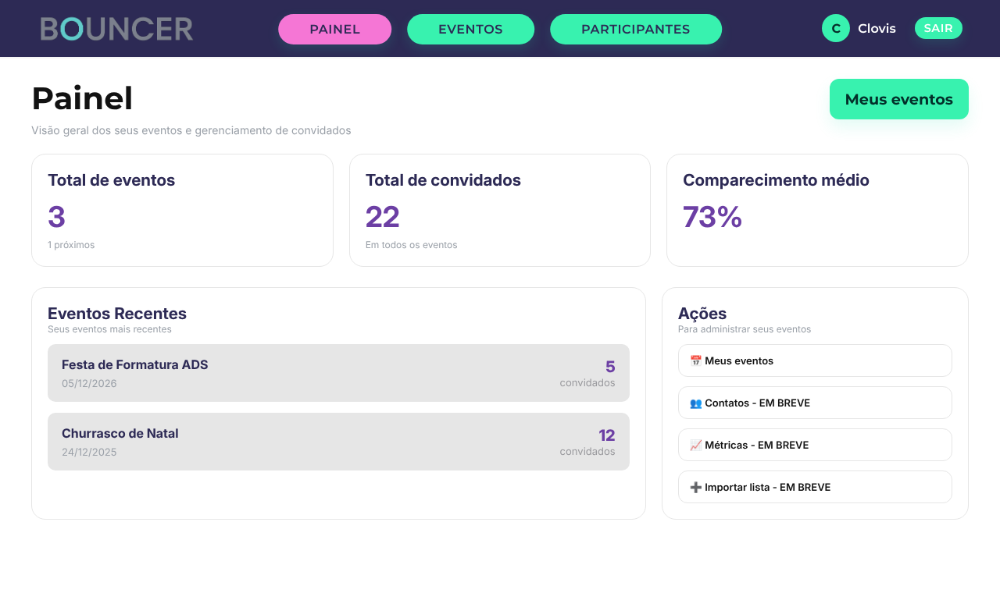
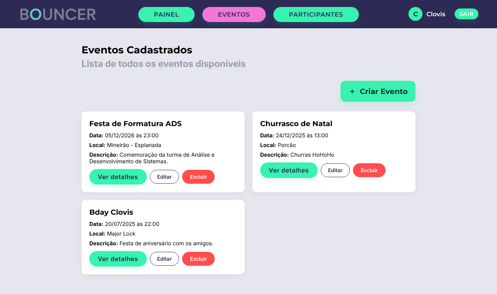
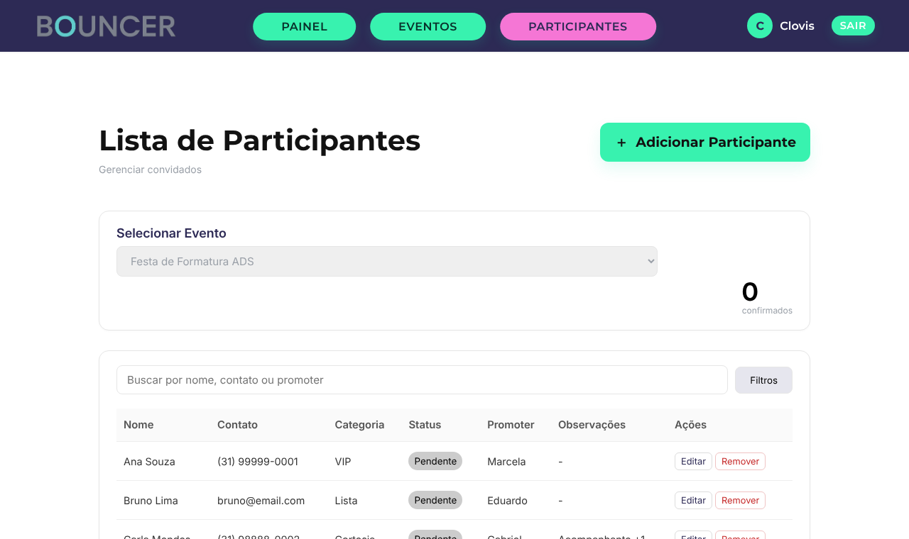

<p align="center">
  
</p>

<p align="center">
  <strong>Gerenciamento de listas de convidados e check-in para eventos</strong><br>
  Projeto acadêmico · Análise e Desenvolvimento de Sistemas · PUC Minas · 2025/2
</p>

<p align="center">
  
  
  
  
</p>

---

## Sobre o projeto

Em baladas, festas e eventos, a lista de entrada ainda costuma ser controlada em planilhas, papel ou mensagens soltas. O resultado é conhecido: filas, nomes faltando, duplicidades e pouca comunicação entre promoters e recepção.

O **Bouncer** é uma aplicação web que centraliza esse processo: o organizador cadastra seus eventos, monta a lista de convidados (com categoria e promoter responsável) e faz o check-in na porta com um clique, acompanhando tudo em um painel com métricas.

🔗 **Acesse:** https://igorlamego.github.io/bouncer/

> **Conta de demonstração** — e-mail `clovis@admin.com` · senha `clovis123`
> (ou crie sua própria conta na tela de cadastro)

## Telas

| Página inicial | Painel |
|---|---|
|  |  |
| **Eventos** | **Lista de participantes** |
|  |  |

## Funcionalidades

- **Cadastro e login** de organizadores, com validação de e-mail e senha
- **Painel** com total de eventos, eventos futuros, total de convidados e taxa média de comparecimento
- **Eventos:** criação, edição e exclusão (data, horário, local, capacidade, descrição e flyer), além de página de detalhes com resumo da lista
- **Lista de convidados** por evento, com contato, categoria (VIP, Lista, Cortesia), promoter e observações
- **Edição e remoção** de participantes
- **Prevenção de duplicidade:** o mesmo nome não entra duas vezes na lista de um evento
- **Controle de capacidade:** aviso ao ultrapassar o limite de pessoas do evento
- **Check-in** com um clique (Pendente ⇄ Confirmado) e contador de confirmados em tempo real
- **Busca** por nome, contato ou promoter (ignora acentos) e **filtros** por categoria e status
- Cada organizador vê **apenas os próprios eventos**
- Layout **responsivo**, com menu hambúrguer no celular

## Tecnologias

- HTML5, CSS3 e JavaScript puro (sem frameworks)
- `localStorage` como persistência de dados no navegador
- GitHub Actions + GitHub Pages para o deploy

> ⚠️ Por ser um projeto de front-end, os dados (inclusive contas) ficam salvos **apenas no navegador** de quem usa. Não há back-end nem criptografia de senha — não use senhas reais.

## Como rodar localmente

Não há dependências. Basta servir a pasta `codigo-fonte`:

```bash
git clone https://github.com/igorlamego/bouncer.git
cd bouncer/codigo-fonte
python3 -m http.server 8000
```

E abrir http://localhost:8000.

## Estrutura

```
codigo-fonte/
├── index.html, login.html, cadastro.html      # páginas públicas
├── dashboard.html, lista-eventos.html,
│   evento.html, guest-list.html               # páginas autenticadas
├── scripts/
│   ├── data.js        # camada de dados (localStorage) + dados de demonstração
│   ├── auth.js        # proteção de rotas
│   └── ...            # um script por página
├── styles/            # um CSS por página
└── assets/            # logos e imagens
documentos/            # documentação acadêmica completa do projeto
```

## Equipe

| Integrante | GitHub |
|---|---|
| Eduardo Vieira Ramos | [@VREduardo](https://github.com/VREduardo) |
| Gabriel Estabanez Ribeiro | [@GabrielEstabanez](https://github.com/GabrielEstabanez) |
| Igor Barcelos Lamego | [@igorlamego](https://github.com/igorlamego) |
| Marcela Almeida de Carvalho | [@marcelaalmeida23](https://github.com/marcelaalmeida23) |

**Orientador:** Prof. Clóvis Lemos Tavares — PUC Minas

## Documentação acadêmica

1. [Documentação de Contexto](documentos/01-Documentação%20de%20Contexto.md)
2. [Especificação do Projeto](documentos/02-Especificação%20do%20Projeto.md)
3. [Metodologia](documentos/03-Metodologia.md)
4. [Projeto de Interface](documentos/04-Projeto%20de%20Interface.md)
5. [Template Padrão da Aplicação](documentos/05-Template%20padrão%20da%20Aplicação.md)
6. [Programação de Funcionalidades](documentos/06-Programação%20de%20Funcionalidades.md)
7. [Plano de Testes de Software](documentos/07-Plano%20de%20Testes%20de%20Software.md)
8. [Registro de Testes de Software](documentos/08-Registro%20de%20Testes%20de%20Software.md)
9. [Referências Bibliográficas](documentos/09-Referências%20Bibliográficas.md)

📽️ [Slides e vídeos de apresentação](apresentacao/README.md)

---

<sub>Projeto desenvolvido originalmente no repositório da turma (ICEI PUC Minas — Projeto de Desenvolvimento de Aplicação Web, Eixo 1). Este repositório é uma cópia mantida para portfólio, com correções posteriores.</sub>
