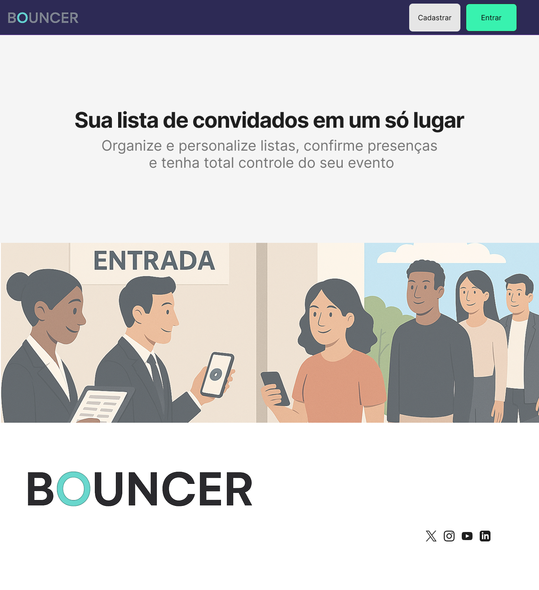

# Projeto de Interface

## User Flow

Fluxo de usuário (User Flow) 

## Protótipo

Desenvolver um protótipo emerge como uma das maneiras mais ágeis e econômicas de validar uma ideia, conceito ou funcionalidade. Isso permite a interação, avaliação, modificação e aprovação das principais características de uma interface antes de entrar na fase de desenvolvimento. Leia o artigo [Protótipos: baixa, média ou alta fidelidade?](https://medium.com/ladies-that-ux-br/prot%C3%B3tipos-baixa-m%C3%A9dia-ou-alta-fidelidade-71d897559135).

### Protótipo de baixa fidelidade

As telas da aplicação web apresentam uma estrutura dividida em três blocos, conforme a imagem abaixo:
<ul>
<li>Cabeçalho - contém o nome da aplicação web e a navegação principal;
<li>Conteúdo - exibe as informações centrais de cada página;
<li>Rodapé - apresenta o nome da aplicação e os links das redes sociais representados por seus respectivos ícones.
 </ul>

<figure> 
 

  

### Tela - Home page

A tela Home Page apresenta, no cabeçalho, a logo da aplicação e os botões “Entrar” e “Cadastrar”.
Na área de conteúdo, há uma breve descrição da aplicação e uma imagem ilustrativa.
</ul>

<figure> 
 

  

## Tela - Login

Na tela de Login temos o cabeçalho exclusivo sem botões adicionais.
No parte do conteúdo, há a sessão de login onde o usuário preenche com email e senha, opção de recuperar sua conta, botão de "entrar" e cadastro, além da opção de entrar utilizando Facebook ou Google.

  

[Elabore as principais interfaces gráficas da aplicação de modo que os requisitos funcionais sejam contemplados nas telas propostas.]

[Adicione aqui as telas da sua aplicação com seus devidos títulos.] 
 
> **Links Úteis**:
> - [Protótipos vs Wireframes](https://www.nngroup.com/videos/prototypes-vs-wireframes-ux-projects/)
>- Ferramentas:
>> - [Pencil](https://pencil.evolus.vn/)
>> - [MarvelApp](https://marvelapp.com/)
>> - [Figma](https://www.figma.com/)

