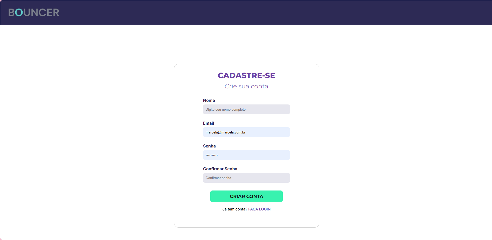
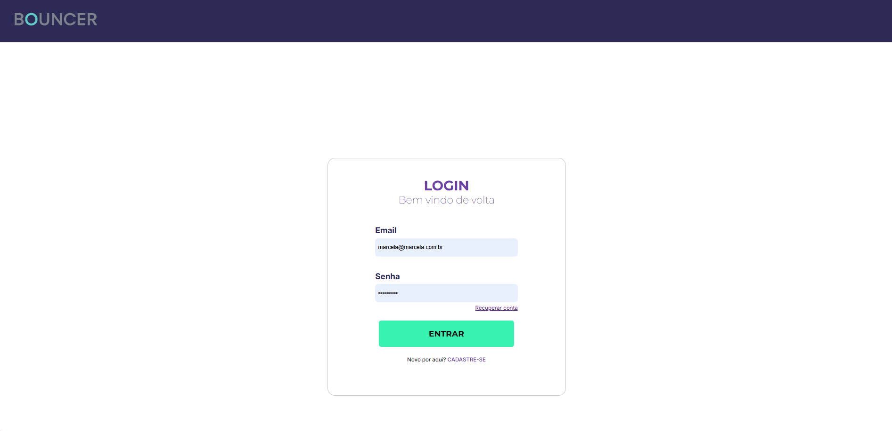

# Programação de Funcionalidades

Implementação da aplicação descritas por meio dos requisitos codificados. 

### Tela de Cadastro

#### Requisito atendido

RF-01 -	A aplicação deve permitir ao usuário cadastrar uma conta.

#### Artefatos da funcionalidade

• cadastro.html

• cadastro.css

• cadastro.js

#### Instruções de acesso

O acesso a tela de cadastro poderá ser feito através da opção de menu “Cadastre-se”.

#### Responsável

Gabriel/Eduardo

### Tela de Login

#### Requisito atendido

RF-02 -	A aplicação deve permitir ao usuário fazer o login da sua conta.

#### Artefatos da funcionalidade

• login.html

• style-login.css

• script-login.js

#### Instruções de acesso

O acesso a tela de login poderá ser feito através da opção de menu “Entrar”.

#### Responsável

Igor

#### Tela de criação de evento

#### Requisito atendido

 A aplicação deve permitir ao usuário criar um evento e inserir os convidados.

 #### Responsável

 Igor

 ### Tela de Lista de Participantes
 

 #### Requisito atendido

 A aplicação deve oferecer uma funcionalidade de filtro/pesquisa para permitir ao usuário localizar listas específicas de convidados e/ou convidados específicos.

 #### Responsável

 Eduardo/Igor

 #### Painel
 

 #### Requisito atendido

 A aplicação deve permitir ao organizador gerar relatórios de presença e ausência de convidados.

  #### Responsável

  Igor

 

 

 
 

 

 

